# GMI Savings Tracker

**An independent, audit-grade check of Maryland's Government Modernization Initiative (GMI), built entirely on the State's open data.** It tests the savings GMI reported against what the State actually paid, finds where more could be saved, and says how sure each number is. Every model has to beat a simple baseline before anything it produces is shown.

> **Live site: https://evo3-ecosystem.github.io/gmi-savings-tracker-v3/** — v3 is the current version. The earlier repositories, gmi-savings-tracker (v1) and gmi-savings-tracker-v2, are superseded and no longer publish a site.

[](https://github.com/EVO3-Ecosystem/gmi-savings-tracker-v3/actions/workflows/ci.yml)
[](https://evo3-ecosystem.github.io/gmi-savings-tracker-v3/)
<!-- facts:badges -->
 
<!-- /facts:badges -->
 

[](LICENSE)

Prototype by Sierra Napier, MPA. Not an official State of Maryland product. **All data comes from the State's open data portal through the SODA API** (opendata.maryland.gov); State websites and DBM's budget books are used only to verify it.

<a href="https://evo3-ecosystem.github.io/gmi-savings-tracker-v3/">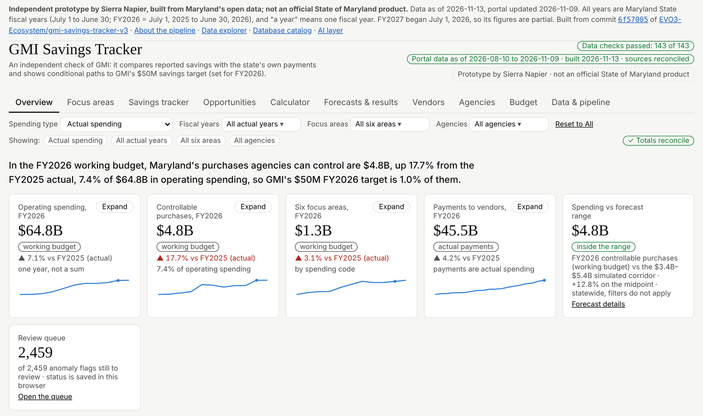</a>

## What it found

<!-- Generated by src/models/doc_facts.py on `make docs`; edit the code, not these lines. -->
<!-- facts:readme -->
- **Reported savings:** GMI's January 26, 2026 report lists 17 items (plus a separate DGS facility estimate). The 4 it describes as saved in FY2026 add up to $29M, its own FY2026 total; the rest are yearly savings under way or projected and are not added to it. The Governor's Government Modernization Initiative page (status as of June 2026) says GMI has implemented actions to save $50M. The two totals count different things and the tracker has verified neither; every figure is kept by source and date in `d_reported_claims`.
- **Payment evidence:** about 14% of the path to $52.6M has payment evidence; the path is conditional on reported savings recurring and an assumed 3.5% from statewide contracts ($42.6M–$64.2M across the assumed ranges).
- **Opportunities:** 389 findings worth up to $330.5M a year ($219.7M likely). They are leads to review; they overlap and are not additive.
- **Payment screen:** 8 possible duplicate payment groups ($1.86M to review). None can be confirmed without payment records.
- **Source data issue:** the published FY2022 payments data lists a second block of $874.5M for Maryland Environmental Service And Maryland Transportation Authority, confirmed on both State sites on Nov 10, 2026. It is reported as a source issue, never as a lead.
<!-- /facts:readme -->

**Live tracking (v4.0):** the open fiscal year is published, not held back. FY2027 payments so far appear in every payment table and on every relevant tab, tagged **FYTD** (fiscal year to date) — never charted against completed years, never counted as a check result. The Savings tracker carries an FY2027 FYTD column so progress against the $50M yearly target is visible as the year unfolds; the checks themselves stay on the two completed years.

**Data accuracy (v3.2):** every actual year FY2017–FY2025 reconciles with DBM's printed budget books (statewide totals within 0.008%, 99.3–100% of programs equal to the dollar), the enacted FY2027 budget equals DBM's Fiscal Digest to the dollar in every fund, and 31 of 31 yearly totals equal the State's Open Finance sites to the cent ([details](#data)).

**Audit depth (v3.1, data as of Nov 13, 2026):**
- **Who pays changed:** 87 program-years moved at least 20 points toward the General Fund in two years. MSDE Child Care Assistance Grants went from 23% General Fund (FY2023) to 79% (FY2025, $562M), matching DLS's ~78%, as federal relief ran out.
- **Federal cross-check:** in the funding data, federal fund source codes are Assistance Listing numbers, so each State budget line can be set beside USAspending obligations for the same program (State FY and federal FY side by side, never added).
- **Payee identity:** 810 companies paid at addresses in more than one ZIP area and 2,368 likely missed name merges, queued for review. The public data has no vendor number, so name and ZIP are the only keys.
- **Audit follow-through:** a lifecycle register (identified, recouped, waived and by whom, legal opinion) seeded only from public sources. The MSDE child care case: $66.5M suspected overpayments reported; $10.7M MSDE decided not to recoup; the fund that paid it is not public.
- **Drift:** the agency mix of payments shifted sharply from FY2021 to FY2022 (PSI 0.32). That is the federal relief period and the year the payments data lists a second $874.5M block, found independently by the payment screen.

## Data science: methods and validation

Every model is scored on held-out data against a baseline it must beat; the registry (`mart.d_model_registry`, Data & pipeline tab) is built from each model's own evaluation in every run, so this table cannot drift from the code.

| Model | Method | Baseline | Held-out result | Decision |
|---|---|---|---|---|
| Spending forecast | Trend, drift, naive or their average per focus area, chosen by rolling-origin MASE | Naive (last actual) | MASE 2.09 vs 2.15, origins FY2021–FY2024 | Adopted |
| Forecast ranges | Bootstrap p10–p90, then **split-conformal widening** (per-horizon factors, Wilson intervals; `src/models/calibration.py`) | Nominal 80% coverage | 53 of 63 past outcomes (84.1%, 95% interval 73–91%) with each outcome year held out; raw ranges under the same design 37 of 63 (58.7%) | Adopted; LightGBM ranges replace them only under a pre-registered rule |
| Spending challenger | LightGBM quantile regression, one global model over 2,609 agency x code series, conformalized bands | Naive | MASE 5.74 vs 6.21; p10–p90 coverage 73% vs 43% before calibration | Adopted for the 1,083 series where it wins; statewide corridor from the statewide miss |
| General Fund revenue | Log-linear trend on sourced closeouts | Naive | MASE 0.94 vs 1.38 | Adopted |
| Payee classifier | TF-IDF character n-grams + logistic regression | Name rules | Macro F1 0.46 vs 0.56 on 364 hand-labeled names | **Not promoted**; feeds a review queue |
| Agency peer groups | K-Means on spending-mix shares, k by silhouette | No groups | Silhouette 0.31, k = 3 | Shown |
| Opportunity detectors | Rules with fixed thresholds, rerun as of FY2022–FY2024 | Like-sized unflagged units | 76% of flagged units flagged again next year vs 5% | Leads, sized with stated rates |
| Anomaly flags | Isolation forest | Rule detectors and bid list | 27% of flags also found by a rule | Review queue only |
| Grant groups | TF-IDF word 1–2 grams, cosine 0.85 | Unsupervised | Leads stable at 0.80 / 0.85 / 0.90 | Leads only |
| Drift monitor | PSI and KS between consecutive fiscal years | 0.10 / 0.25 thresholds | 1 major shift (FY2021–FY2022) | Warns, never blocks |

Model cards: [`docs/models/`](docs/models). Gates in force: export refuses a failed build; nothing is adopted that loses to its baseline; savings are never inferred from a model's output.

<table>
<tr>
<td width="50%">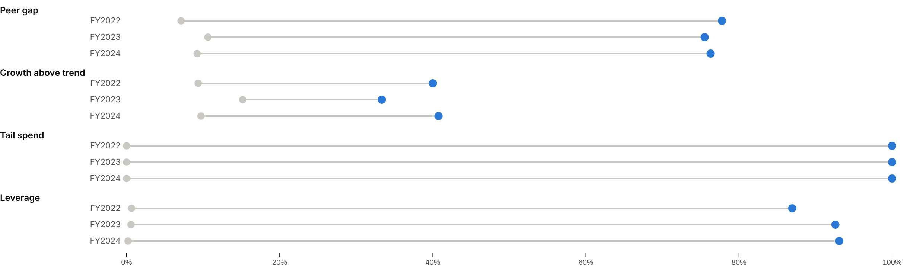<br><b>Detector backtest.</b> Flags persist: real signal, not noise.</td>
<td width="50%">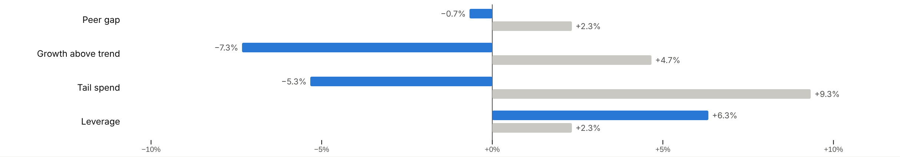<br><b>What flagged spending did next.</b> Growth flags fall back; part of a spike is one year. Descriptive, not causal.</td>
</tr>
<tr>
<td>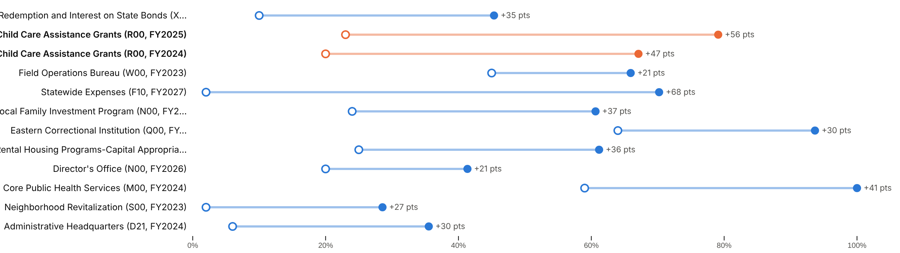<br><b>Fund shifts.</b> General Fund share two years before and after, largest programs.</td>
<td>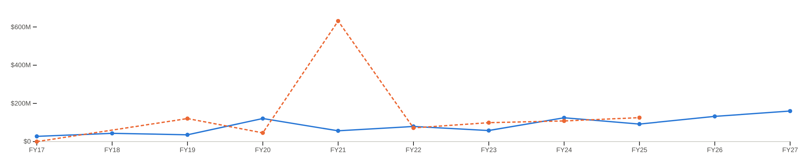<br><b>Federal cross-check.</b> CCDBG (93.575): State budget beside federal obligations.</td>
</tr>
<tr>
<td>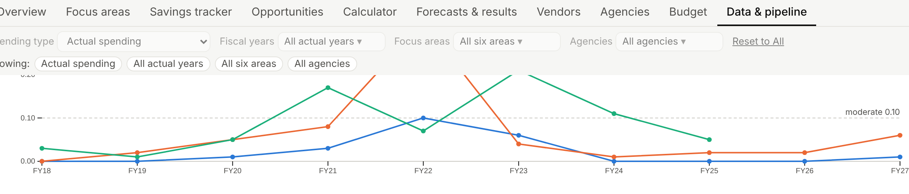<br><b>Drift monitor.</b> PSI by year with the 0.10 and 0.25 thresholds.</td>
<td>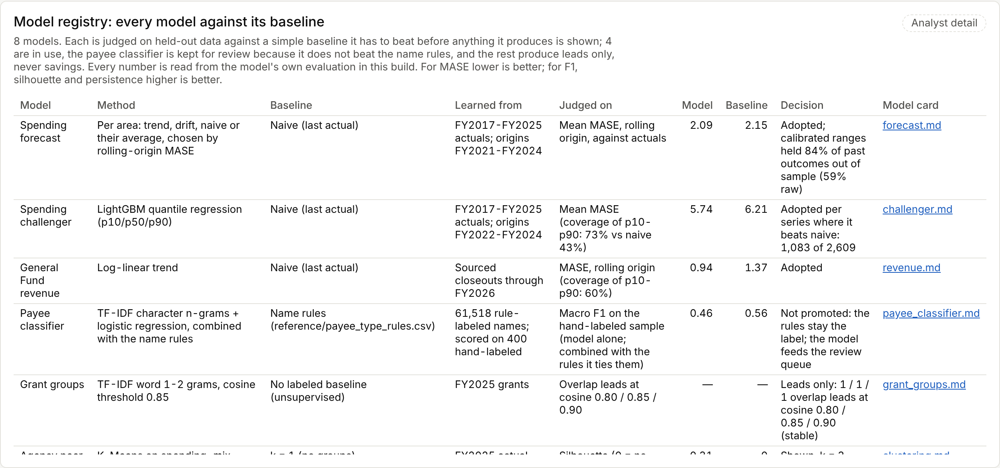<br><b>Model registry.</b> Every model against its baseline, read from this build.</td>
</tr>
</table>

## Live demo

**https://evo3-ecosystem.github.io/gmi-savings-tracker-v3/**

| Page | What it shows |
|---|---|
| Dashboard | <!-- n:tabs_Word -->Eleven<!-- /n --> tabs: overview, executive walkthrough, focus areas, savings tracker, opportunities, calculator, forecasts and results, vendors, agencies, budget, data and pipeline; every chart has an Analyst detail panel (what it shows, method, how to read it, caveats, data vintage) |
| Models & analysis (`models.html`) | Every model card with its live registry score, and the analysis figures |
| Walkthrough (`walkthrough.html`) | The analysis notebook, rendered |
| AI layer (`ai.html`) | Payment screen, payee classifier, grant overlap, MCP server and briefs, each with its baseline and limits |
| Data explorer (`explorer.html`) | SQL in the browser (DuckDB-WASM) over every published table |
| Database catalog (`catalog.html`) | Every table's layer, rows, columns, checks and lineage |

<table>
<tr>
<td width="50%"><a href="https://evo3-ecosystem.github.io/gmi-savings-tracker-v3/">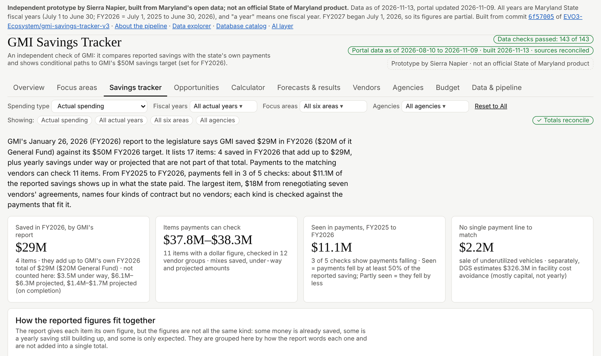</a><br><b>Savings tracker.</b> GMI's 17 items grouped by how the report words them; the four saved items equal its $29M.</td>
<td width="50%"><a href="https://evo3-ecosystem.github.io/gmi-savings-tracker-v3/">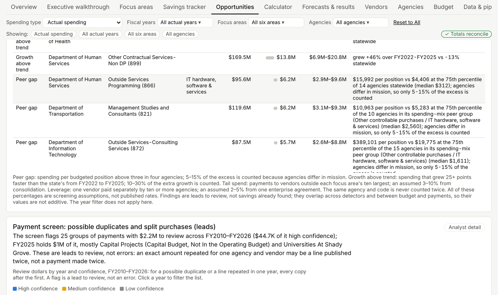</a><br><b>Payment screen.</b> 8 leads by confidence; the FY2022 double listing is a source issue, never a lead.</td>
</tr>
<tr>
<td><a href="https://evo3-ecosystem.github.io/gmi-savings-tracker-v3/">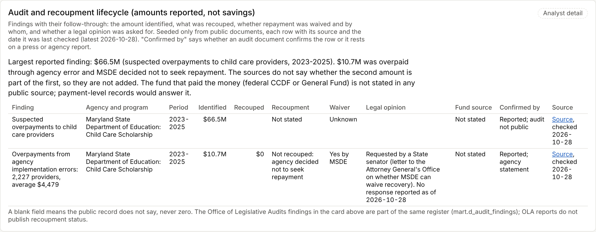</a><br><b>Audit lifecycle.</b> Identified, recouped, waived, legal opinion; every row sourced and dated.</td>
<td><a href="https://evo3-ecosystem.github.io/gmi-savings-tracker-v3/">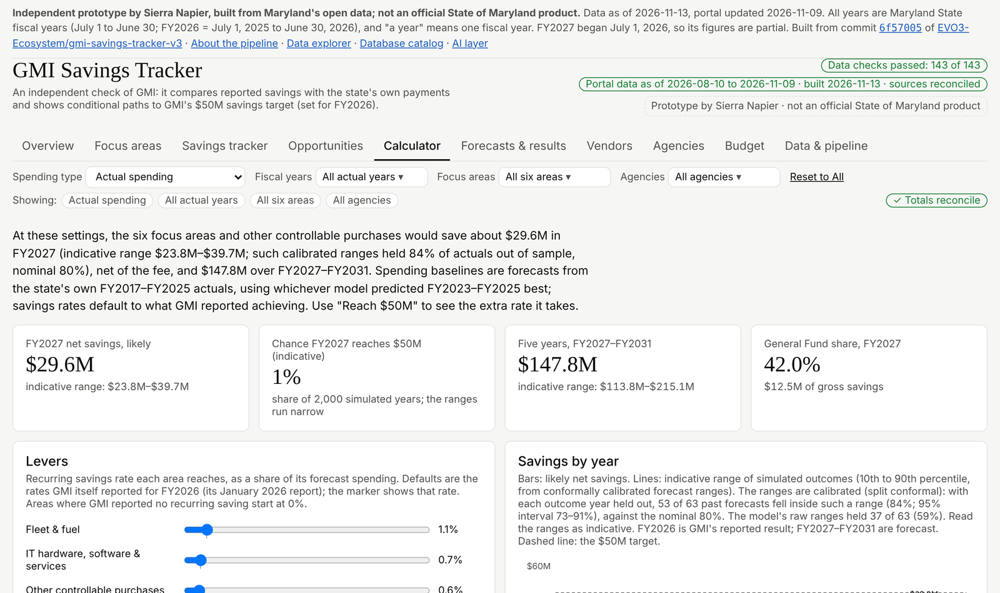</a><br><b>Calculator.</b> The conditional path to $50.2M with calibrated ranges.</td>
</tr>
<tr>
<td><a href="https://evo3-ecosystem.github.io/gmi-savings-tracker-v3/ai.html">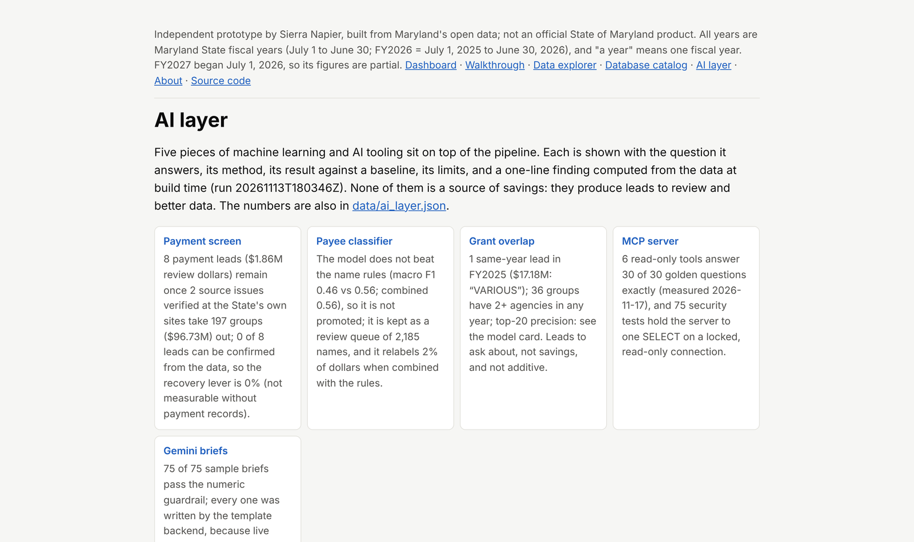</a><br><b>AI layer.</b> Each model with its baseline, result and limits.</td>
<td><a href="https://evo3-ecosystem.github.io/gmi-savings-tracker-v3/explorer.html">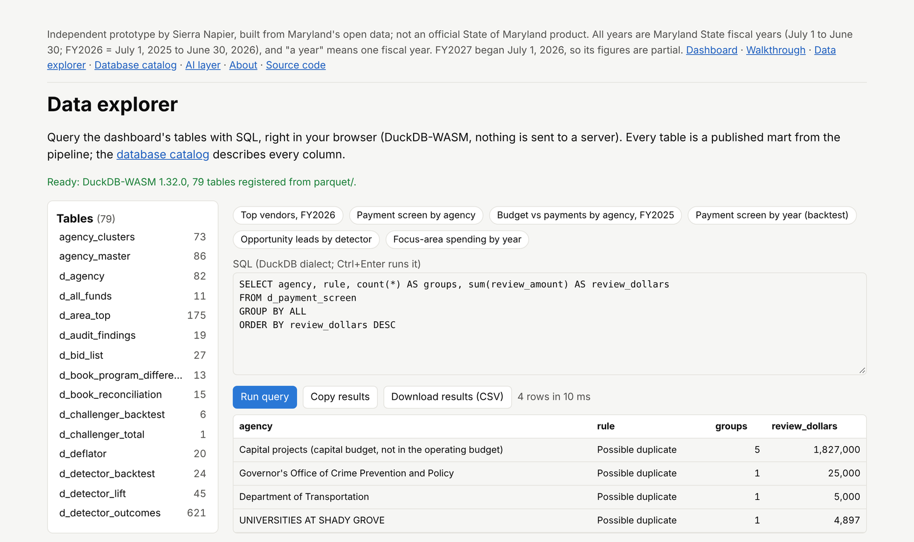</a><br><b>Data explorer.</b> SQL over every published table, in the browser.</td>
</tr>
</table>

## Data

| Dataset | Portal ID | Rows | Years | Matches portal | Verified against | Notes on the source |
|---|---|---|---|---|---|---|
| Operating budget | [yu65-jmmv](https://opendata.maryland.gov/d/yu65-jmmv) | 741,957 | FY2017–FY2027 | Yes, every year | mtp.maryland.gov download; operatingbudget.maryland.gov totals | The portal's stage labels are out of date (FY2021 "Working", FY2022 "Appropriation", FY2027 "Governor's Allowance"); stages come from DBM's budget books |
| Funding source | [gy87-e27x](https://opendata.maryland.gov/d/gy87-e27x) | 26,178 | FY2017–FY2027 | Yes, every year | budgetsource.maryland.gov download | Same stage labels as the budget |
| Payments | [7syw-q4cy](https://opendata.maryland.gov/d/7syw-q4cy) | 412,880 | FY2008–FY2027 (FY2027 partial, published as FYTD) | Yes, every year | vendorpayments.maryland.gov download and totals | Title says FY2008–FY2024 but the data runs to FY2027. Yearly totals per payee, not payments (the date is always Jan 1). FY2022 lists a second $874.5M block. Refreshed on the portal after the Nov 9 extract; re-extracted Nov 10 |
| Grants and loans | [absk-avps](https://opendata.maryland.gov/d/absk-avps) | 23,085 | FY2009–FY2025 | Yes, every year | grantsandloans.maryland.gov download | The portal says grants of $50,000 or more, but some rows are smaller |
| Budgeted full-time equivalents (FTEs) | [x8qy-486w](https://opendata.maryland.gov/d/x8qy-486w) | 6,026 | FY2017–FY2027 | Yes, every year | The portal's own count and totals only | Values are FTEs (1,578 rows are fractional), not position counts. The portal page reads the same table as the API, and no separate State website publishes it (checked Nov 10, 2026); a check against DBM's budget documents is planned |
| Public higher education budget | [4mca-332u](https://opendata.maryland.gov/d/4mca-332u) | 84,446 | FY2017–FY2027 | Yes, every year | The portal's own count and totals only | Reported separately and kept out of every savings baseline |

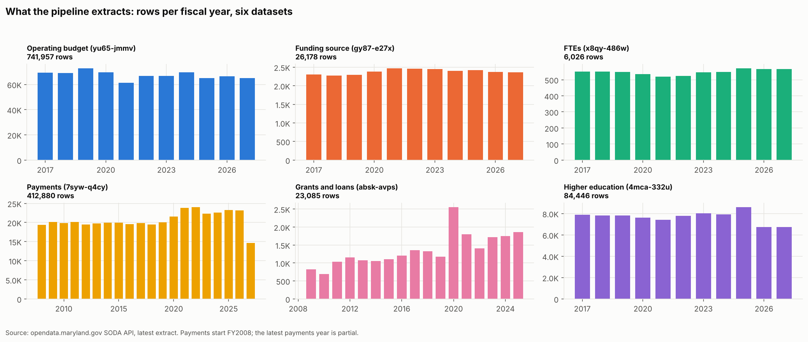

Counts are from the Nov 10, 2026 run; the same notes appear on the dashboard's Data & pipeline tab (`reference/source_notes.csv`). Every run checks each dataset's row count and yearly totals against the portal's own figures before anything is built.

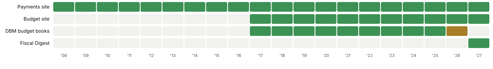

**Reconciled with the State's own documents, every year (v3.2, Nov 16, 2026)** (`src/pipeline/books.py`, Data & pipeline tab). Every result below is stored as sourced reference data and re-tested by a stop check on every build:

| Check | Years | Result |
|---|---|---|
| Yearly totals against the Open Finance sites (operatingbudget / vendorpayments.maryland.gov) | Budget FY2017–FY2027, payments FY2008–FY2027 | 31 of 31 equal to the cent |
| Program actuals against DBM's Governor's budget books (Actual column, printed two years later) | FY2017–FY2025 | 9 of 9 years reconcile: statewide totals within $5.4M (0.008%), 99.3–100% of programs equal to the dollar |
| Enacted budget against DBM's FY2027 Fiscal Digest (Exhibit B), by fund | FY2027 | General, special and federal funds equal to the dollar; 626 of 626 programs |
| Working budget bridge: appropriation + enacted deficiencies (Digest Exhibit E) | FY2026 | $482.4M remainder, labelled as budget amendments; DBM prints the working appropriation in the FY2028 books |
| General fund walk: allowance + Supplemental Budgets 1 and 2 + the Legislature's cuts and additions (DLS conference report) | FY2027 | Within $6.1M (0.02%) of the enacted figure; DLS reports to $0.1M |

The identity that makes the books tie: **book Total Expenditure − reimbursable funds − non-budgeted funds = operating budget (yu65-jmmv) + public higher education (4mca-332u).** Reimbursable funds (paid by one agency to another) and non-budgeted funds (MDTA, MES, the Stadium Authority, State Retirement investments) are printed in the books but not appropriated in the State budget, and the open data does not carry them. Only 13 programs differ across nine years, each listed with its reason in `reference/book_program_differences.csv`: four small programs in the data but not printed in the books ($8.8M), one $9,000 difference, and eight rounding differences of $1–$16. Also checked: the four website downloads match the API year by year (`make reconcile`).

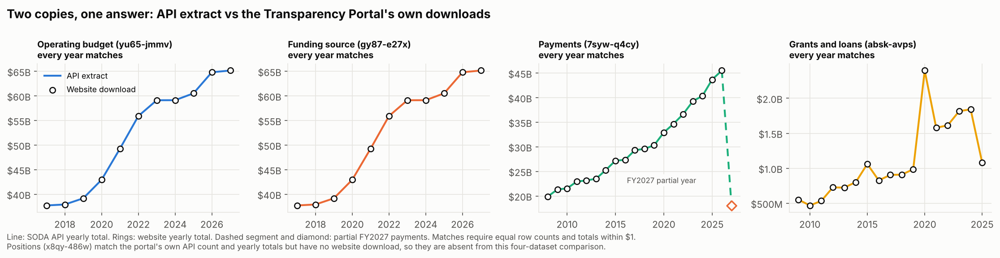

**Known source issues** (`docs/data-governance.md`):
- The payments and grants data hold yearly totals per payee, not individual payments: the date field is always January 1. Timing rules (duplicate windows, split purchases, monthly forecasts) cannot run on this data.
- The portal's budget and FTE descriptions use out-of-date stage labels, so stages come from `reference/budget_stage.csv`, checked against DBM's budget books.
- The FY2022 payments double listing described above.
- Payee mapping is incomplete: every payment dollar since FY2010 maps to a budget agency, but 38.6% of FY2026 payment dollars sit in the default payee type "Business or other", and non-profits (0.2%) are under-identified. The payee classifier's review queue lists the likely misses.

Context sources (`src/pipeline/enrich.py`; a failure warns, never blocks): CPI-U (BLS, with FRED as fallback), federal awards to Maryland (USAspending), population (Census) and every agency's Managing for Results plan (DBM).

**API version.** The extract uses the SODA 2.1 endpoints (`/resource/<id>.json`) through `sodapy`, which work without a token; Tyler Technologies says SODA 2.1 remains fully supported. The SODA3 endpoint (`/api/v3/views/<id>/query.json`) requires an app token; see [Next steps](#next-steps).

**What the open data cannot answer** (Data & pipeline tab, `reference/field_availability.csv`): 4 of the 13 fields an audit-grade tracker needs are public. Payment and invoice numbers and dates, the fund on each payment and vendor numbers sit in FMIS; MD-VIEW shows them one search at a time with no download and is never scraped. The schema for payment-level records is ready (`src/pipeline/txn.py`, `core.fact_payment_txn`), so a Public Information Act response loads with no code change.

## How it works

<picture>
  <source media="(prefers-color-scheme: dark)" srcset="docs/figures/readme/pipeline_dark.png">
  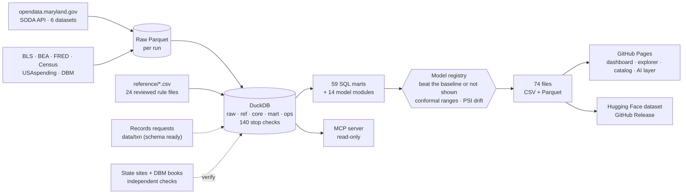
</picture>

| Step | Module | Result |
|---|---|---|
| Extract | `src/pipeline/extract.py`, `enrich.py` | One Parquet file per dataset per run with a manifest; context from BLS, BEA, FRED, Census, USAspending and DBM (a failure warns, never blocks) |
| Build and check | `build.py`, `checks.py` | DuckDB layers raw, ref, core, mart, ops; <!-- n:checks -->143<!-- /n --> checks; a failed stop check keeps the last good database |
| Reconcile | `books.py`, `reconcile.py` | Every year against DBM's budget books, the Fiscal Digest and the Open Finance sites; results stored as sourced reference data and re-tested every build |
| Rules | `reference/` (<!-- n:reference_files -->30<!-- /n --> files) | Every mapping and decision in a reviewed file with its reason and source |
| Marts | `sql/mart/` (<!-- n:marts -->62<!-- /n --> files) | The tables the dashboard reads; one mart per file, lineage recorded |
| Models | `src/models/` (16 modules) | Forecasts, challenger, revenue, detectors and their backtest, savings checks, payment screen, classifier, grant groups, anomaly flags, registry and drift |
| Publish | `export.py`, `site.py`, `publish.py` | Export refused unless every stop check passes; static site; data release |
| AI access | `src/mcp/`, `src/briefs/` | Read-only MCP server; one-line briefs with a number guardrail |

Quality bar: <!-- n:documented_columns -->2,394<!-- /n --> columns catalogued and 2,340 documented, the rest listed in `docs/data-governance.md` (`reference/column_dictionary.csv`), every figure on the page read from a published file, all financial figures by Maryland fiscal year (July 1–June 30).

## Tech stack

The architecture is the diagram and step table above. This is what it is built with.

- **Language and environment:** Python 3.12 with dependencies locked by `uv` (`uv.lock`, exported to `requirements.lock.txt`); a Make target for every step; Docker and `compose.yaml` build the same locked environment.
- **Extraction and data handling:** `sodapy` (the Socrata SODA 2.1 client), pandas, PyArrow, `pdfplumber` (DBM's budget books), PyYAML and requests.
- **Storage:** Parquet (one file per dataset per run, and the published tables in `site_data/`) and DuckDB with the layers `raw`, `ref`, `core`, `mart` and `ops`. DVC is configured for an optional local store (`dvc.yaml`); it is not a locked dependency.
- **Models:** scikit-learn (K-Means, TF-IDF, Isolation Forest, logistic regression), LightGBM quantile regression, and split-conformal calibration (`src/models/calibration.py`). The model registry and the PSI and KS drift monitor are in `src/models/registry.py`. Sentence embeddings for grant groups are an optional extra; TF-IDF is the default.
- **Quality and governance:** pytest (the data-free tests run in CI), stop checks (`src/pipeline/checks.py`), reviewed CSV rules and dictionaries in `reference/` (<!-- n:reference_files -->30<!-- /n --> files), governance docs generated from the data (`src/pipeline/governance.py`), and ruff.
- **Presentation:** a static site built by `src/pipeline/site.py` and served from GitHub Pages. D3.js is inlined in the page, so the dashboard loads nothing from another host; the SQL explorer loads DuckDB-WASM from jsDelivr (the one external request, with a plain JavaScript fallback). Figures come from matplotlib, the walkthrough notebook is executed with nbclient, and Playwright drives the page tests and the README screenshots.
- **AI access:** a read-only Model Context Protocol server over stdio (`src/mcp/`), and one-line briefs with a number guardrail (`src/briefs/`). The template backend needs nothing; the optional Gemini backend uses `google-genai`.
- **Delivery:** GitHub Actions runs CI (lint, compile check, tests, the forecast rebuild check, the notebook check and a container test), the Pages deploy, the data release to GitHub and Hugging Face, a monthly extract and build (the 3rd), and weekly freshness alerts (Mondays). A branch ruleset requiring the `test` check on `main` is defined in `.github/rulesets/main.json`, and Dependabot keeps the Actions and pip dependencies current.

## AI layer

| Piece | Result | Limit |
|---|---|---|
| Payment screen | 8 leads, $1.86M to review; a confirmation rate is not measurable | Yearly totals, not payments |
| Payee classifier | Not adopted: macro F1 0.46 against 0.56 for the rules. Kept as a review queue of 2,185 names | Labels from one annotator |
| Grant overlap | After resolving renamed agencies, 2 of the top 20 groups are real overlaps | Leads only, not additive |
| MCP server | 6 read-only tools; 30 of 30 test questions answered exactly; 75 security tests | Local use (Claude Desktop or Claude Code) |
| Briefs | 75 of 75 template briefs pass the number guardrail | Live Gemini is off by choice; needs `GEMINI_API_KEY` |

## Run it

<details open>
<summary>Commands</summary>

Python 3.12 (`.python-version`). Dependencies are locked in `uv.lock`; `requirements.lock.txt` is the same set for pip.

```bash
uv sync --frozen --extra dev --extra mcp --extra notebook   # the locked environment (pip: pip install -r requirements.lock.txt && pip install --no-deps -e .)
docker compose run --rm test        # or run the tests in the container built from the lockfile
make forecast-check                 # rebuild the forecast from the published tables and compare with what was published
make notebook                       # execute the walkthrough notebook, render it, refresh docs/figures/overview/
make all                            # extract, then build and check
make test                           # tests; data-dependent ones skip when data/ is absent
make export                         # dashboard files (refused after a failed build)
make site                           # static site in site/ from data/export/latest, else site_data/
make site-artifact ARTIFACT_OUT=... # the same site without Parquet, for a claude.ai artifact
make reconcile                      # website downloads vs the API (about 750 MB)
make docs                           # data governance, schemas and generated facts
make readme-shots                   # the README screenshots, from the built site
python -m src.mcp.server            # MCP server over stdio (docs/mcp.md has the client setup)
python -m src.briefs.generate       # briefs (template backend without a key)
python -m src.pipeline.publish --dry-run   # validate a data release without network
```

All `make` targets: extract, extract-full, extract-scheduled, build, all, test, test-fault, reconcile, parity, export, snapshot, restore, figures, diagrams, docs, docs-strict, site, site-snapshot, site-artifact, readme-shots.

Secrets: `MD_SODA_APP_TOKEN` (optional for SODA 2.1, required for SODA3), `HF_TOKEN` (Hugging Face upload), `GEMINI_API_KEY` (live briefs). Copy `.env.example` to `.env` for local use; in CI they are repository secrets. None is ever committed.

</details>

## Repository layout

<details>
<summary>Folders</summary>

```
config/        datasets, dashboard files, assumptions
reference/     reviewed rules, decisions, audit register, field availability, DBM and site reconciliation figures (CSV)
sql/mart/      one SQL file per mart
src/pipeline/  extract, enrich, build, checks, marts, txn, books, export, site, publish, reconcile, parity, governance
src/models/    forecasts, challenger, revenue, detectors, backtest, savings, payment screen, classifier, grant groups, anomaly, registry
src/mcp/       read-only MCP server
src/briefs/    briefs and their guardrail
tests/         pytest
docs/          data governance, model cards, checks, reconciliation, parity, reviews, roadmap, v3.1 strategy
site_data/     checked-in export snapshot the Pages site is built from
data/          git-ignored: raw runs, database, exports, data/txn for records-request files
legacy/        the original pandas pipeline and dashboard, kept as the parity baseline
```

</details>

## Follow the analysis without running the pipeline

- [Walkthrough notebook](notebooks/walkthrough.ipynb): the story end to end from the published tables only, committed with its outputs.
- [Executive overview](docs/executive-overview.md): one page, six figures (`docs/figures/overview/`).
- [Model cards](docs/models): <!-- n:model_cards -->12<!-- /n --> cards, each with its baseline, validation and limits.

## Status

| Phase | State |
|---|---|
| 1–4. Extract, database, reference data, marts and dashboard | Done, Oct 28–Nov 2, 2026 |
| 5. Analytics and verification | Done, Nov 16, 2026: detector backtest on the page, model registry, drift monitor, conformal ranges, State-site cross-checks, published-file parity |
| v3.1 Audit depth | Released Nov 16, 2026: fund hierarchy, federal cross-check, payee alias review, audit lifecycle register, payment-level schema, model registry, drift monitor |
| v3.2 Data accuracy | Released Nov 16, 2026: every year reconciled with DBM's budget books, the Fiscal Digest and the State's Open Finance sites |
| Release 3.2.0 on GitHub | Published Nov 17, 2026: tags `v3.1.0` and `v3.2.0`, GitHub releases, site deployed from `main` |
| v4.0 Live tracking | Nov 20, 2026: FY2027 payments (partial year) published in every table, tagged FYTD; Savings tracker FYTD column; registry separates latest-completed from FYTD; repo inventory, refresh plan and gap-fix map in `docs/` |
| Program screen and walkthrough | Merged Nov 17, 2026: the statewide program screen with audit findings linked through the register, and the accessible walkthrough report |
| Community | Set up Nov 17, 2026: Discussions (Q&A and Ideas), issue chooser links, support routing, tech stack section |
| 6. Automate | Workflows in place (weekly freshness run, monthly extract and build, Pages, ruleset, Dependabot). The monthly extract and build run has not completed yet; it needs a working Socrata token |
| 8. AI apps | AI page, MCP server and guarded briefs built; live generation off by choice |

## Limitations

- Payments and grants are yearly totals per payee, not payments: no duplicate-window, split-purchase or monthly analysis can be confirmed without payment-level records.
- Detector and anomaly results are leads. The backtest is descriptive: flagged and unflagged units differ in more than the flag.
- Forecast calibration rests on 63 scored points over four origins (Wilson interval 73–91%); the factors are re-estimated every run and coverage is a check. The statewide spending corridor rests on three backtest origins.
- The audit register holds only what public sources state; a blank is unknown, never zero.

## Next steps

- Sierra's review of the 8 payment leads (`docs/reviews/payment_screen_review_sheet.csv`) and the 400 payee labels (`reference/payee_labels_sample.csv`).
- Public Information Act requests: the Comptroller for payment-level MSDE records (FY2023–FY2025), and MSDE for audit, recoupment and waiver records.
- January 2027: when DBM posts the FY2028 budget books, add them to `src/pipeline/books.py` so FY2026's working budget becomes an exact check instead of a bridge.
- Scheduled runs: the monthly Extract and build runs on the 3rd (first scheduled run Dec 3, 2026); a manual run on Nov 18 passed every step. It needs no token: the datasets are public, a valid `MD_SODA_APP_TOKEN` only raises the request limits, and a rejected one is dropped with a warning. A data-refresh PR (published `site_data/`, which would publish `mart.d_program_screen`) is the next data step.
- Phase 7, BI as an application (see [docs/roadmap.md](docs/roadmap.md)): an Explore view with Plotly and filters, hosted questions in plain English, a metric registry and exception-based alerts, hosted on Cloudflare.
- Live demo of the dashboard inside the portfolio: [goaiarchitect.com/demo/gmi-savings-tracker.html](https://goaiarchitect.com/demo/gmi-savings-tracker.html).
- Move the extract to SODA3 with `MD_SODA_APP_TOKEN`, keeping SODA 2.1 as a fallback.

Questions, ideas and feedback: [Discussions](https://github.com/EVO3-Ecosystem/gmi-savings-tracker-v3/discussions) (Q&A and Ideas). Bugs and data issues: [Issues](https://github.com/EVO3-Ecosystem/gmi-savings-tracker-v3/issues/new/choose). Security: [SECURITY.md](SECURITY.md).

History, decisions D1–D9 and the gap list: [docs/roadmap.md](docs/roadmap.md). Data governance: [docs/data-governance.md](docs/data-governance.md). Checks: [docs/checks.md](docs/checks.md). Every file and its refresh owner: [docs/repo-inventory.md](docs/repo-inventory.md). The global refresh plan and the asset-to-source map: [docs/refresh-plan.md](docs/refresh-plan.md). Every known gap and its fix: [docs/gap-fixes.md](docs/gap-fixes.md).

## License

**© 2026 Sierra Napier. All rights reserved.** This repository represents proprietary analytical architecture and portfolio code; commercial use, reproduction, or redistribution without express written permission is prohibited. You may read it and run it locally to evaluate the work; see [LICENSE](LICENSE).

Data: Maryland open data, subject to the portal's terms; DBM and DoIT do not guarantee its accuracy or completeness.
