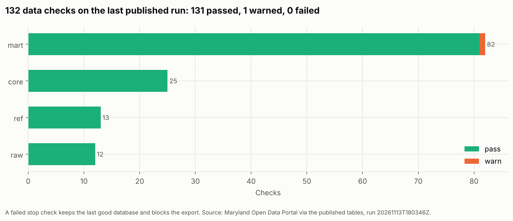
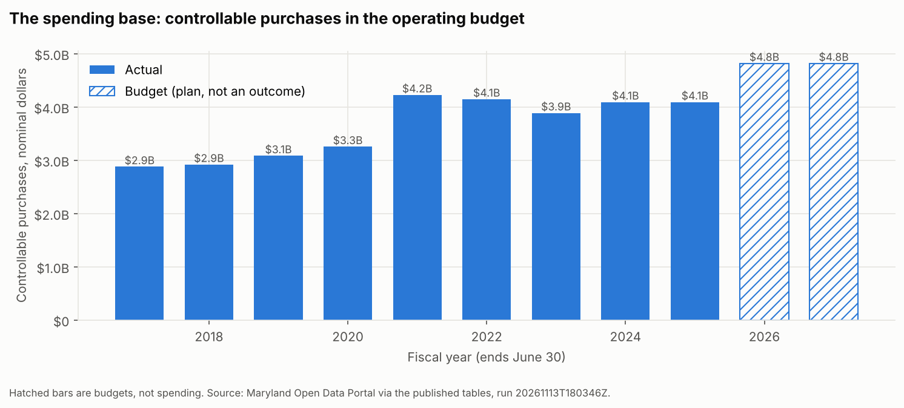
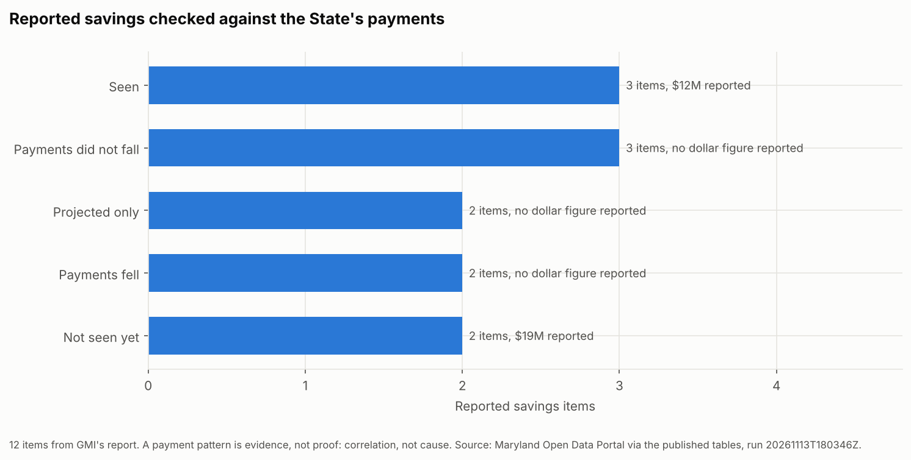
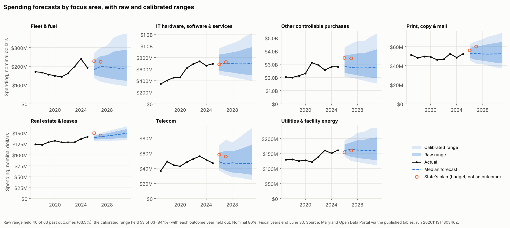
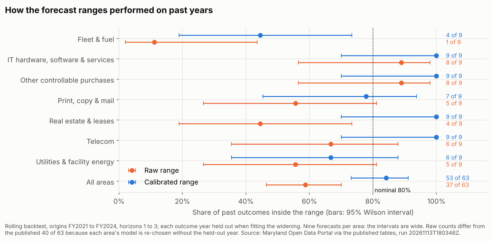
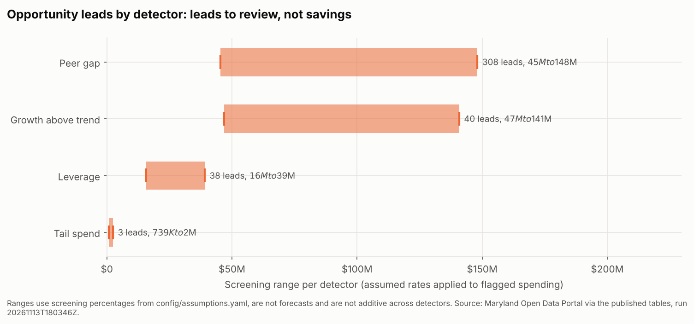

# Executive overview

*One page for a reader who will not open the code. Every figure below is computed from the published tables of run `20261113T180346Z` in [the walkthrough notebook](../notebooks/walkthrough.ipynb); fiscal years end June 30.*

## The question
Maryland's Government Modernization Initiative (GMI) reported savings and set a target of about $50M a year. This project checks the reported savings against the State's own payment data, forecasts the spending the savings come from, and lists where the next savings might be.

## What the data is
Six datasets from the Maryland Open Data Portal. Row counts and yearly totals match the portal for all six, and 132 data checks ran on the last published run: 131 passed and 1 warned (the forecast range, below).

## The spending base
Controllable purchases in the operating budget were $4.1B in FY2025, the last year with actuals. FY2026 and FY2027 are budgets, not outcomes.

## Reported savings against payments
Twelve reported items can be paired with payments. Three are **seen** in the payments ($11.5M reported), two are **not seen yet** ($18.8M reported), two show payments falling and three show payments not falling where no dollar figure was reported, and two are projections only. A fall in payments is evidence, not proof.

## The forecast, and how far to trust its range
Each area's forecast uses the simplest model that wins on past years. The published range was meant to hold 80% of outcomes and held 40 of 63 (63.5%). A calibrated range is now published beside it. With each outcome year held out, it held 53 of 63 (84.1%; the 95% interval is 73% to 91%). It is one pooled correction: Fleet & fuel remains under-covered (4 of 9).

## Leads, not savings
Four detectors flag 389 leads. Applying screening percentages to the flagged spending gives $109M to $331M, but these are leads to review, the percentages are assumptions, and the ranges are not additive. The 30-step path table reaches $53M, of which $29.6M is GMI's own reported rates applied to forecast FY2027 spending.

## What is not known
- Whether any lead becomes a saving: no review outcomes are recorded, so no hit rate is claimed.
- Whether LightGBM ranges beat the calibrated range for the first forecast year: the rule is written down and coded; the answer needs a pipeline run.
- How the calibrated range performs on FY2026: actuals are not in yet.

## Next steps
1. Run the pipeline in GitHub Actions to produce the LightGBM, revenue and detector figures.
2. Let two scheduled runs complete and compare their table checksums.
3. Record review outcomes for leads, so the detectors can be scored on what happened.
